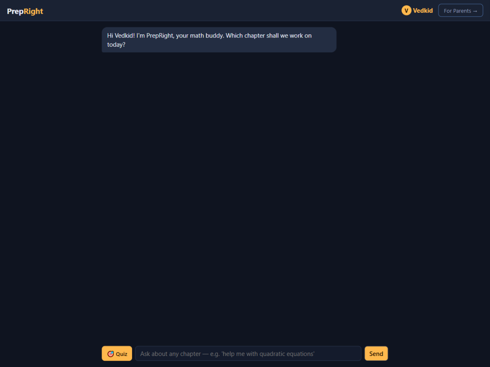
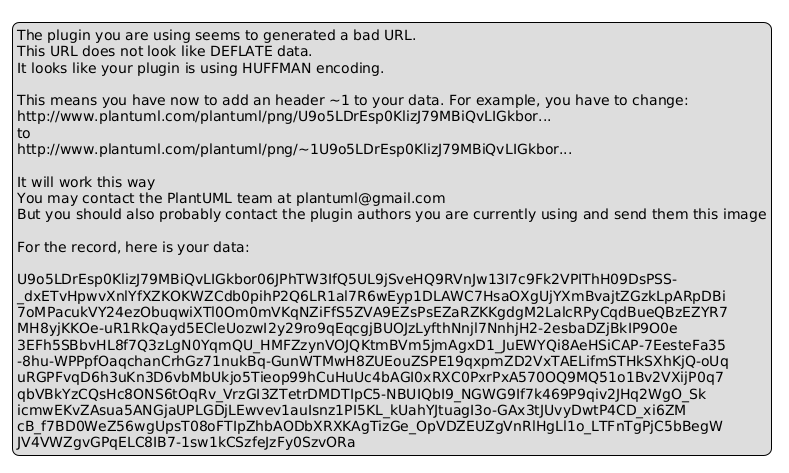
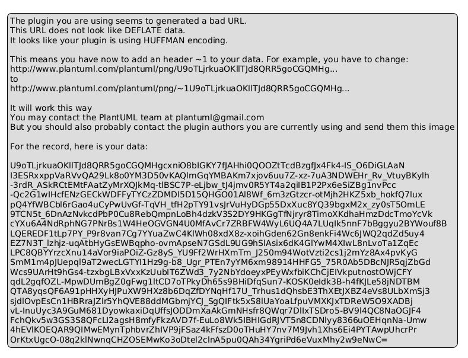

# PrepRight

[](https://github.com/vedant-9/prepright/actions/workflows/ci.yml)

**An AI math tutor for school kids (CBSE Class 8–10) that can't teach them wrong math.**

Kids chat, learn, and practice. Parents see exactly where their child is strong or struggling.



## Why this exists

Chatbots make patient, encouraging tutors — except they sometimes invent wrong answers, confidently. For a 12-year-old, that's worse than no help at all. PrepRight fixes exactly that: **the AI writes the questions, but a math engine (SymPy) computes every answer and every grade.** No exceptions.

## Features

**Students get**
- chat tutoring grounded in a verified concept corpus — no improvised definitions
- practice quizzes with tappable options and instant green/red grading
- a tutor that remembers them across sessions
- kid-safe boundaries: PII redaction, off-topic screening, identity enforced server-side

**Parents get**
- PrepScore per child (0–100, weighted by CBSE unit marks)
- strong / struggling chapter flags from real practice results
- weekly report cards with one suggested activity
- kid profile management behind a parent PIN

## How the math stays correct



The language model drafts each question as a machine-readable spec — never an answer. SymPy computes the answer, a coherence check verifies the numbers match the wording, and wrong-option traps are generated from real misconceptions. Questions that fail verification are dropped, not patched.

Quizzes cover what has a computable answer — algebra, equations, number systems, expression evaluation. Proof-based chapters (geometry theorems, trigonometric identities) are taught from the concept corpus instead, because there is no single answer to compute.

## Under the hood



A LangGraph agent (guardrail → model → 8 tools) with a 3-model fallback chain, RAG concept lookup, and per-student conversation memory. Provider SDKs are imported by exactly one file, so swapping models touches nothing else.

## Quick start

```bash
git clone <repo-url> && cd prepright
python -m venv .venv && source .venv/bin/activate
pip install -r requirements.txt

cp .env.example .env
# Add your free API keys:
#   GROQ_API_KEY from https://console.groq.com/keys
#   GEMINI_API_KEY from https://aistudio.google.com/apikey

uvicorn app.main:app --port 8000
```

Open `http://127.0.0.1:8000`

## Tech stack

| Layer | Technology |
|---|---|
| Agent | LangGraph StateGraph, AsyncSqliteSaver |
| LLM | Groq gpt-oss-120b → gpt-oss-20b → Gemini (model chain) |
| Verification | SymPy (arithmetic, equations, quadratics, GCD/LCM) |
| Retrieval | Gemini embeddings, cosine similarity, disk-cached |
| Backend | Python 3.12, FastAPI, SSE streaming |
| Database | SQLite (WAL, append-only events) |
| Frontend | Vanilla JS, zero dependencies |
| Auth | Session tokens (Bearer, 24h expiry) |

## Testing

```bash
pytest tests/ -v          # 62 tests, zero network
python -m evals.run_evals # retrieval golden set + quiz integrity
```

<!-- Demo GIF: after quota reset, record the flow (teach → quiz → graded)
     and reference assets/demo.gif here, above "Why this exists". -->
