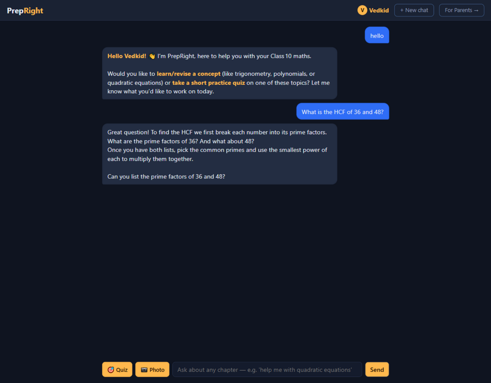
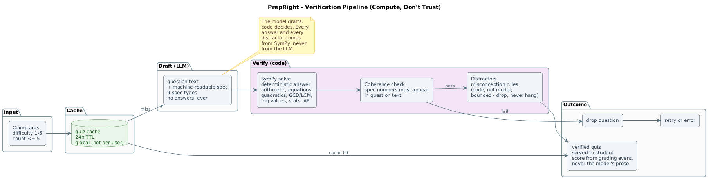
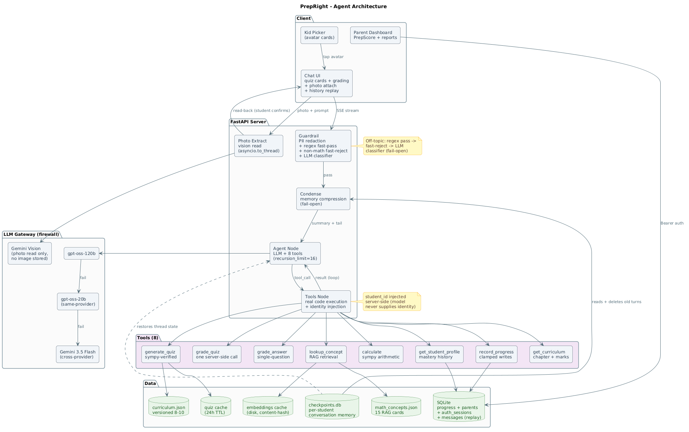

# PrepRight

[](https://github.com/vedant-9/prepright/actions/workflows/ci.yml)

**An AI math tutor for school kids (CBSE Class 8–10) that can't teach them wrong math.**

Kids chat, learn, and practice. Parents see exactly where their child is strong or struggling.



## Why this exists

Chatbots make patient, encouraging tutors — except they sometimes invent wrong answers, confidently. For a 12-year-old, that's worse than no help at all. PrepRight fixes exactly that: **the AI writes the questions, but a math engine (SymPy) computes every answer and every grade.** No exceptions.

## Features

**Students get**
- chat tutoring grounded in a verified concept corpus — no improvised definitions
- practice quizzes with tappable options and instant green/red grading
- a tutor that remembers them across sessions — and a chat that does too: the full conversation replays when they return
- snap a photo of a notebook problem instead of typing math — the tutor reads it back for confirmation before teaching
- a fresh start anytime: *New chat* clears the conversation but keeps every score
- kid-safe boundaries: PII redaction, off-topic screening, identity enforced server-side

**Parents get**
- PrepScore per child (0–100, weighted by CBSE unit marks)
- strong / struggling chapter flags from real practice results
- weekly report cards with one suggested activity
- kid profile management behind a parent PIN

**Photos stay private by design.** Location metadata is stripped before a photo leaves the phone, the image exists in server memory only while being read, and nothing is ever stored — the photo lives on in the student's chat on their own device, as a local thumbnail other devices never see.

## How the math stays correct



The language model drafts each question as a machine-readable spec — never an answer. SymPy computes the answer, a coherence check verifies the numbers match the wording, and wrong-option traps are generated from real misconceptions. Questions that fail verification are dropped, not patched. Quiz scores shown to the student come from the grading event itself, never from the model's retelling.

Quizzes cover what has a computable answer — algebra, equations, number systems, exact trigonometric values, statistics, arithmetic progressions. Proof-based chapters (geometry theorems, trigonometric identities) are taught from the concept corpus instead, because there is no single answer to compute.

## Under the hood



A LangGraph agent (guardrail → condense → model → 8 tools) with a 3-model fallback chain, RAG concept lookup, and per-student conversation memory that compresses itself as sessions grow long. Provider SDKs — chat, embeddings, and photo vision — are imported by exactly one file, so swapping models touches nothing else.

## Quick start

```bash
git clone <repo-url> && cd prepright
python -m venv .venv && source .venv/bin/activate
pip install -r requirements.txt

cp .env.example .env
# Add your free API keys:
#   GROQ_API_KEY from https://console.groq.com/keys
#   GEMINI_API_KEY from https://aistudio.google.com/apikey

uvicorn app.main:app --port 8000
```

Open `http://127.0.0.1:8000` — works on phones too.

## Tech stack

| Layer | Technology |
|---|---|
| Agent | LangGraph StateGraph, AsyncSqliteSaver, conversation compression |
| LLM | Groq gpt-oss-120b → gpt-oss-20b → Gemini (model chain) |
| Verification | SymPy (arithmetic, equations, quadratics, GCD/LCM, trig values, statistics, AP) |
| Photo input | Gemini vision, echo-back confirmation, zero image storage |
| Retrieval | Gemini embeddings, cosine similarity, disk-cached |
| Backend | Python 3.12, FastAPI, SSE streaming |
| Database | SQLite (WAL, append-only events) |
| Frontend | Vanilla JS, zero dependencies, phone-friendly |
| Auth | Session tokens (Bearer, 24h expiry) |

## Testing

```bash
pytest tests/ -v          # 100 tests, zero network
python -m evals.run_evals # retrieval golden set + quiz integrity
```
